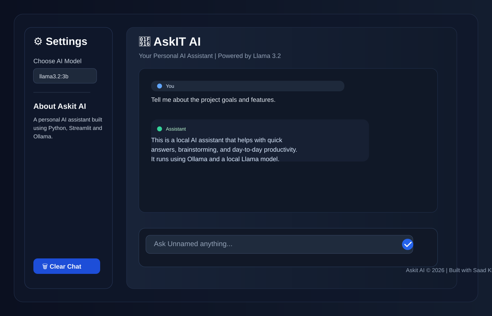
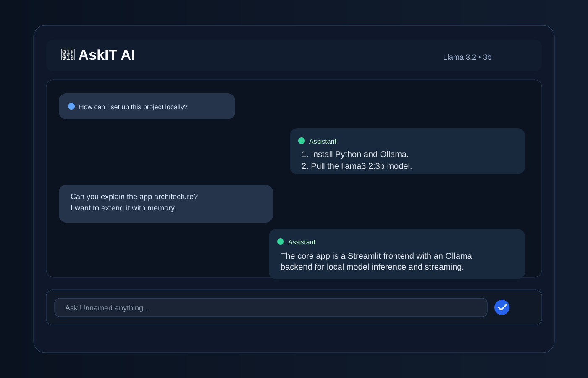
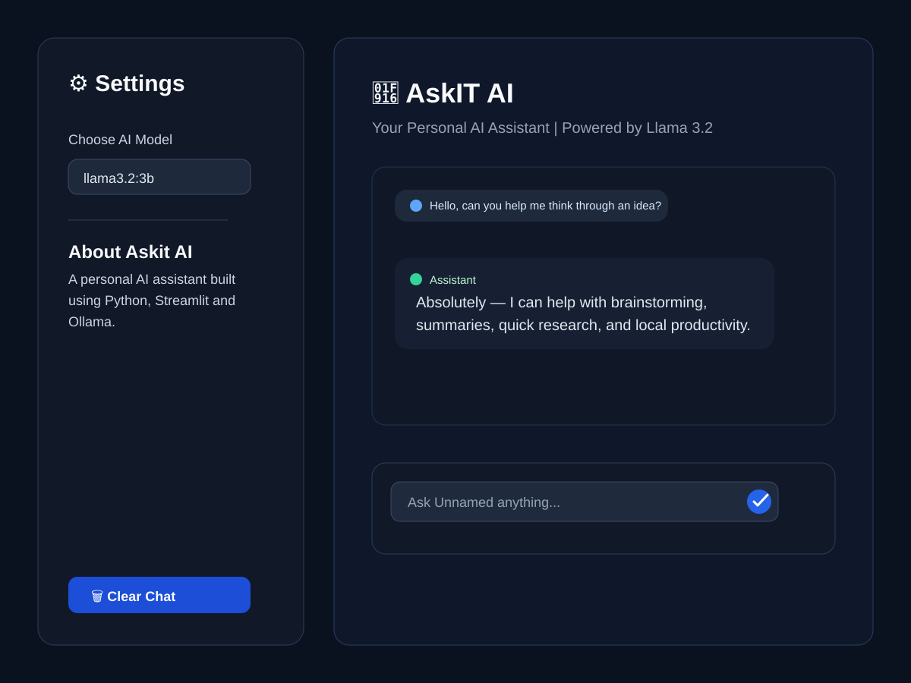

# Askit AI

Askit AI is a lightweight personal AI assistant built with Python, Streamlit, and Ollama. It provides a clean chat interface for local AI inference using a small Llama model, making it easy to run on a local machine without relying on a cloud API.

The app is intentionally simple and fast to set up, ideal for experimentation, learning, and personal productivity.

## Overview

AskIT AI is designed to feel like a personal assistant in a minimalist interface. The application lets you:

- Start a local chat session with an AI model
- Choose the model from the sidebar
- Stream responses in real time
- Clear the chat history whenever required
- Use Ollama as the backend for local model hosting

## Features

- Streamlit-based chat UI
- Local model inference via Ollama
- Streaming text responses for a natural chat flow
- Sidebar settings and status information
- Quick chat reset with one-click clear action
- Simple architecture that is easy to extend

## Tech Stack

- Python 3
- Streamlit
- Ollama
- Llama 3.2:3b model

## Screenshots

### Main chat interface



### Conversation experience



### Settings sidebar



## Project Structure

```text
Askit AI/
├── app.py                # Main Streamlit application
├── requirements.txt      # Python dependencies
├── test_ollama.py        # Basic Ollama connectivity test
├── README.md             # Project documentation
├── LICENSE               # MIT license
├── LICENSES.md           # Additional licensing reference
├── assets/
│   ├── askit-ai-dashboard.svg
│   ├── askit-ai-chat.svg
│   └── askit-ai-sidebar.svg
└── .venv/                # Local virtual environment
```

## Prerequisites

Before running the app, make sure you have:

- Python 3.10 or newer
- A working Ollama installation
- The Llama model pulled locally

Install Ollama from the official site and then pull the model:

```bash
ollama pull llama3.2:3b
```

## Installation

1. Clone the repository

```bash
git clone <repository-url>
cd "Askit AI"
```

2. Create and activate a virtual environment

```bash
python -m venv .venv
.venv\Scripts\activate
```

3. Install dependencies

```bash
pip install -r requirements.txt
```

4. Run the app

```bash
streamlit run app.py
```

The app should open in your browser, and you can begin interacting with the AI assistant.

## Running the Basic Ollama Check

The repository also includes a small connectivity test:

```bash
python test_ollama.py
```

This script sends a basic prompt to the local Ollama server and prints the model response.

## Usage

Once the app is running:

1. Open the Streamlit app in your browser
2. Type a prompt in the chat box
3. Select the model from the sidebar (currently `llama3.2:3b`)
4. Review the streaming response from the AI
5. Use the Clear Chat button to reset the conversation

## Configuration

The app uses the following default configuration:

- Page title: `AskIT AI`
- Page icon: `🤖`
- Layout: centered
- Model: `llama3.2:3b`

You can change the model from the sidebar menu at runtime.

## Troubleshooting

### Ollama connection errors

If you see an error related to Ollama, verify that:

- Ollama is installed and running
- The `llama3.2:3b` model has been downloaded
- Your local machine allows the required connection to the Ollama service

```bash
ollama list
```

If the model is missing, run:

```bash
ollama pull llama3.2:3b
```

### Streamlit issues

If the app does not start:

```bash
streamlit --version
python --version
```

Then reinstall dependencies:

```bash
pip install -r requirements.txt
```

## Future Improvements

Potential additions for this project include:

- Chat history persistence
- PDF or document upload support
- User authentication
- Custom prompt templates
- Multiple model selection and comparison
- Conversation export features
- Better UI customization and branding

## Contributing

Contributions are welcome. If you want to improve the project:

1. Fork the repository
2. Create a feature branch
3. Commit your improvements
4. Open a pull request with a clear summary

## License

This project is licensed under the MIT License. See [LICENSE](LICENSE) and [LICENSES.md](LICENSES.md) for details.

## Credits

- Built with Python
- UI powered by Streamlit
- Local LLM access through Ollama
- Project branding and UI by the Askit AI team

## Notes

This project is a simple local AI assistant prototype and is intended for educational, personal, and experimental use. It is easy to extend into a more production-ready assistant with memory, tools, and deployment support.
